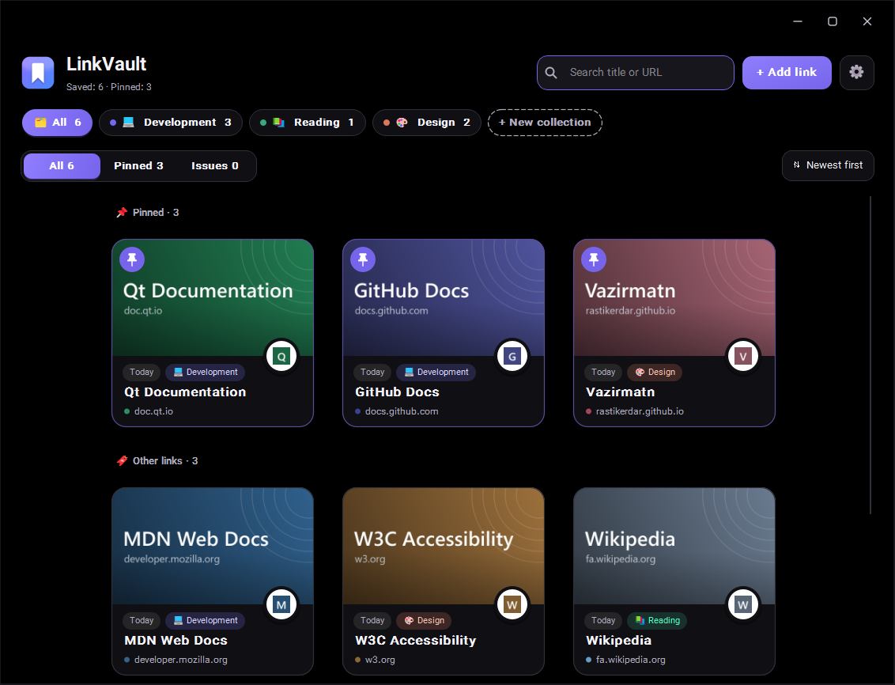

# LinkVault 4.1

LinkVault is a desktop and mobile bookmark manager built with C++17 and Qt 6. Save a link, group it into a collection, and search your library by title or URL.



## What's new

- Save a short note with a bookmark. The library, command palette, and smart collections can search that note.
- Choose **+ New collection → New smart collection** to save rules by keyword, website, or when a link was added. For example, enter `youtube.com` and choose **This week**. Matching links appear automatically.
- Open **Notes** on the library page for a separate notebook with categories, search, colors, pinned notes, and countdowns. Specify a deadline or a duration such as **90 minutes**. Select **Show this note in the widget** to choose which note the widgets show.
- Use **Desktop widget** in Notes to open a floating panel on Windows, Linux, or macOS. On Android and iOS, add **LinkVault Notes** from the system widget picker.
- English interface for the library, command palette, dialogs, settings, and Windows installer. Bookmark titles and collection names keep their original text.
- Light, Dark, System, and Black themes. Black uses a pure black workspace with distinct cards and controls. On Windows, the Black theme suspends the Mica background while selected.
- Shorter page transitions, theme crossfades, card movements, and scrolling. Turn **Animations** off under **Settings → Appearance** to disable these effects.
- Touch layouts for phones and tablets with swipeable collections, tap targets for pinning and bookmark menus, and scrolling in the library and settings. To edit a collection on a touch screen, press and hold its chip.
- JSON backups include collections and bookmarks. LinkVault 4 can still import older LinkVault JSON backups and browser-exported bookmarks in HTML format.

## Packages

| Platform | Package |
| --- | --- |
| Linux x86_64 | AppImage. Make the file executable and run it. |
| macOS Apple Silicon and Intel | Universal DMG. Drag the app into Applications. |
| Android 9+ on arm64 | APK. The preview build uses Android test signing. |
| iOS 16+ on arm64 | Unsigned app bundle for developers. A device build needs your Apple development identity and provisioning profile. |
| Windows 10/11 x64 | Inno Setup installer or portable ZIP. Extract the entire ZIP before opening LinkVault.exe. |

The [package workflow](https://github.com/Manixpcshot/LinkVault/actions/workflows/packages.yml?query=branch%3Av4.1) builds the Linux, macOS, Android, and iOS packages. The macOS build is provided without Apple notarization.

Standalone notebook entries are stored locally and included in JSON backups. Desktop folder sync carries bookmark notes and smart collection rules. Use LinkVault 4.1 on each device that writes to the same sync folder to preserve those fields. The Android launcher displays a live countdown and the system may defer its final refresh in the background. On iOS, sign `io.github.manixpcshot.linkvault` and `io.github.manixpcshot.linkvault.notes` with the same team, and enable the `group.io.github.manixpcshot.linkvault` App Group on both provisioning profiles. Add the widget after opening the signed app and saving a note.

Windows retains the custom frame, Mica, and system-wide hotkeys. Linux and macOS use native window frames and in-app shortcuts. Close-to-tray requires an available desktop system tray. Folder sync is a desktop feature. Mobile libraries can be moved using **Export** and **Import** in Settings. Mobile reminders are checked while the app runs.

## Build from source

Use Qt 6.8.3, a C++17 toolchain, CMake 3.21 or newer, and Ninja. From a shell configured for your Qt kit:

```sh
qt-cmake -S . -B build -G Ninja -DCMAKE_BUILD_TYPE=Release
cmake --build build --parallel
```

On Windows, run `build.bat` to build and deploy the app into `dist`, or `build_setup.bat` with Inno Setup 6 to build the installer. On Linux and macOS see the commands in [the package workflow](.github/workflows/packages.yml). Android needs the Qt arm64 kit, host Qt, JDK 17, the Android SDK, and NDK r26b. The iOS workflow uses the Qt iOS kit and Xcode.

Existing Windows installations use the same data directory and settings identifiers as LinkVault 3.0. Bookmarks stay in the application data directory until you export a backup or enable desktop folder sync.

[Third-party notices](THIRD-PARTY-NOTICES.md) · [Version history](CHANGES.md)
